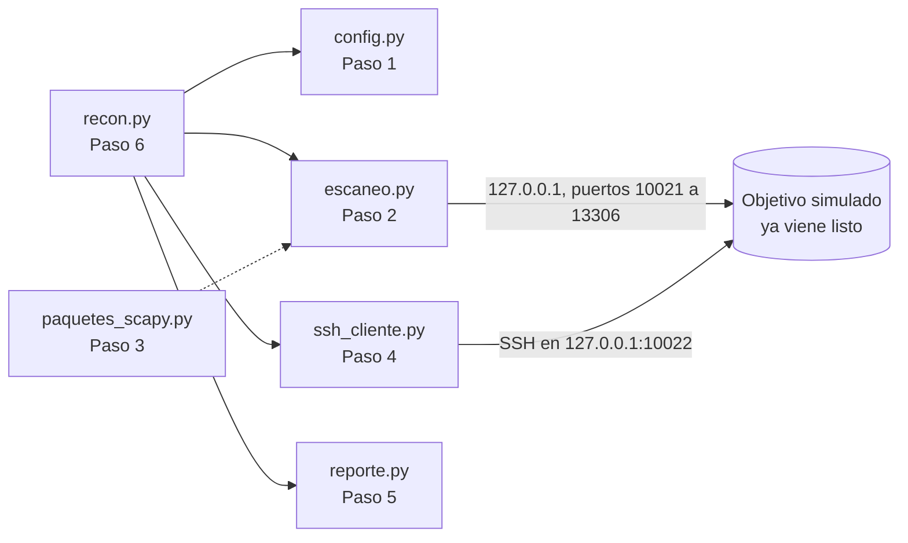

<!-- Idioma del documento: es-CO (español de Colombia) -->
# Guía paso a paso: reconocimiento controlado con Scapy y SSH

En esta carpeta usted **construye la herramienta archivo por archivo**. En cada paso
crea un archivo, pega el código que le da la guía, lo ejecuta y comprueba el resultado.
El código viene **comentado línea a línea para quien ve Python y este tema por primera
vez**: cada elemento del lenguaje se explica la primera vez que aparece. Leer esos
comentarios es la parte más importante del laboratorio.

La idea de fondo es sencilla: para conocer un equipo, primero se mira **qué puertas
tiene abiertas** (puertos), y luego, en las que lo permiten, se entra con una llave
(usuario y clave) para **preguntarle datos**. Todo contra un objetivo simulado que
vive en su propio computador.

Siglas que va a encontrar: TCP (Transmission Control Protocol, protocolo de control de
transmisión), SSH (Secure Shell, consola remota cifrada), SFTP (SSH File Transfer
Protocol, transferencia de archivos sobre SSH), IP (Internet Protocol, dirección del
equipo en la red), CIDR (Classless Inter-Domain Routing, forma de escribir un rango de
direcciones como 127.0.0.0/8) y JSON (JavaScript Object Notation, formato de texto para
datos estructurados).

## Antes de empezar

### Qué ya viene en esta carpeta y qué crea usted

| Ya viene listo (no lo modifique) | Para qué sirve |
|---|---|
| `servicios_simulados.py`, `simulador_lab06.py` | Hacen de "objetivo": un servidor SSH que responde con datos de ejemplo y un par de puertos abiertos, todo en `127.0.0.1`. |
| `pasos/` | Scripts de comprobación de los pasos 1, 2 y 5 (en los pasos 3, 4 y 6 se ejecuta directamente el archivo creado). |
| `validar.py` | Validación final del reporte (después del Paso 6). |
| `test_escaneo_local.py`, `test_ssh.py`, `test_seguridad.py` | 14 pruebas automáticas que revisan su código. |
| `ejecutar_laboratorio.sh`, `limpiar.sh` | Comprobación final completa y limpieza. |

| Lo crea usted (pegando el código de la guía) | Paso |
|---|---|
| `config.py` | 1 |
| `escaneo.py` | 2 |
| `paquetes_scapy.py` | 3 |
| `ssh_cliente.py` | 4 |
| `reporte.py` | 5 |
| `recon.py` | 6 |

### Cómo trabajar cada paso

1. **Lea el concepto** del paso: explica qué va a construir y por qué.
2. **Antes de ejecutar, prediga** en voz alta qué cree que va a mostrar. Comparar su
   predicción con lo que sale es la mejor forma de entender qué hace el código.
3. **Cree el archivo** con su editor, dentro de esta carpeta. Por ejemplo, `code config.py`
   (VS Code) o `nano config.py`.
4. **Copie el bloque de código completo** de la guía y péguelo. En GitHub, cada bloque
   tiene un botón de copiar en la esquina superior derecha.
5. **Guarde** y **ejecute la comprobación** del paso; compare su salida con la esperada.
6. **Lea los comentarios del código** (las líneas con `#` y los textos entre `"""`).

Si algo no funciona, lo más común es que el código se haya pegado incompleto o con la
sangría cambiada. Compare su archivo con la respuesta: `diff config.py ../solucion/config.py`
(si no muestra nada, son idénticos). Equivocarse y corregir es parte del camino.

### Cómo se ve el laboratorio



No hay máquinas virtuales ni otros equipos: el objetivo escucha solo en `127.0.0.1`,
así que ningún paquete sale de su computador. Cada servicio queda en su puerto estándar
más 10 000 (SSH, que usa el 22, pasa a 10022), de modo que no necesita permisos de
administrador ni choca con servicios reales de su equipo.

### Requisitos

- Linux, macOS o Windows con WSL (Windows Subsystem for Linux, subsistema de Linux para Windows).
- Python 3.10 o superior, con `venv` y `pip`.
- Un editor de código (VS Code, nano o vim).
- Conocimientos previos: **no necesita saber Python**; los comentarios del código lo
  explican desde cero. Si ya trabajó con `socket` en un laboratorio anterior, reconocerá
  la idea de "abrir una conexión a un puerto": aquí la usamos para saber si está abierto.

Trabaje con **dos terminales abiertas en esta carpeta**: la terminal A para el objetivo
simulado y la terminal B para todo lo demás.

### Python mínimo para este laboratorio

Si nunca ha usado Python, lea esto una vez; el resto lo explican los comentarios del código.

- **Un programa de Python es un archivo de texto** que termina en `.py`.
- **Se ejecuta desde la terminal** con `python3 nombre_del_archivo.py`.
- **`python3 -c "..."`** ejecuta instrucciones escritas directamente en la terminal.
- **Los comentarios** empiezan con `#` y los textos entre `"""` describen archivos y
  funciones. Python no los ejecuta: son explicaciones para usted.
- **La sangría (los espacios al inicio de la línea) es obligatoria** y define qué líneas
  van dentro de una función, un `if` o un `for`: 4 espacios por nivel, nunca tabulaciones.
- **Mayúsculas y minúsculas importan:** `Print` y `print` son cosas distintas.
- **Un archivo puede usar lo que define otro** de la misma carpeta con `from config import TARGET_HOST`.
- **Cómo leer un error.** Si algo falla, Python muestra un `Traceback`. Lea primero la
  **última línea**: dice qué pasó. `ModuleNotFoundError: No module named 'config'` significa
  que falta el archivo `config.py` o que no está en esta carpeta.

## Paso 0: preparar el entorno

En la **terminal B**, prepare el **entorno virtual**: una carpeta (`.venv`) con un Python
propio para este laboratorio, para que lo que instale aquí no afecte al resto del equipo.

```bash
python3 -m venv .venv               # crea el entorno virtual en la carpeta .venv
source .venv/bin/activate           # lo activa: el inicio de la línea mostrará (.venv)
pip install -r requirements.txt     # instala paramiko (SSH) y scapy (paquetes de red)
python3 -c "import paramiko, scapy; print('Dependencias OK')"
```

**Prediga:** ¿qué cree que imprimirá la última línea si todo salió bien?

Salida esperada: `Dependencias OK`. Active el entorno (`source .venv/bin/activate`) en
**ambas** terminales: cada terminal nueva empieza sin él.

## Paso 1: la configuración central (`config.py`)

**Concepto.** Todos los valores que podrían cambiar (a qué equipo se apunta, qué puertos
se miran, de dónde salen las credenciales) viven en un solo archivo. Aquí está también
la **red permitida**: la herramienta se niega a actuar sobre cualquier dirección que no
esté dentro de ella. Es el primer control de uso responsable, y la clave nunca se escribe
en el código: se lee del entorno.

Cree el archivo `config.py`, pegue este código y guárdelo:

<!-- archivo: config.py -->
```python
"""
config.py - Configuración central del reconocimiento (Paso 1).

Este texto entre tres comillas dobles es un DOCSTRING: una nota que describe el
archivo. Python no la ejecuta; está ahí para quien lee el código.

Qué hace este archivo: guarda en un solo lugar los valores que podrían cambiar
(a qué equipo se apunta, qué puertos se miran, qué red está permitida y de dónde
salen las credenciales). Los demás archivos toman estos valores de aquí.

Glosario de redes:
  - Host: el equipo con el que hablamos. "127.0.0.1" (también llamado "localhost"
    o "loopback") es SU PROPIO computador: el tráfico nunca sale de él.
  - Puerto: número de 0 a 65535 que identifica a un servicio dentro de un equipo.
    Por costumbre, SSH (Secure Shell, consola remota cifrada) usa el 22.
  - Red: conjunto de direcciones escrito como 127.0.0.0/8 (notación CIDR, Classless
    Inter-Domain Routing): el /8 indica cuántos bits iniciales son fijos.
"""
import ipaddress  # incluido en Python: entiende direcciones y redes IP
import os          # incluido en Python: lee variables del entorno del sistema

# Las líneas que empiezan con # son COMENTARIOS: Python las ignora por completo.
# Sirven para explicar el código. En este laboratorio hay muchos: léalos todos.

# ---------------------------------------------------------------------------
# OBJETIVO Y RED PERMITIDA
# ---------------------------------------------------------------------------
# Una VARIABLE es un nombre que guarda un valor. El signo = significa "guardar":
# a la izquierda el nombre, a la derecha el valor. Lo que va entre comillas es TEXTO.
# Por costumbre, los valores que no cambian se escriben en MAYÚSCULAS.
TARGET_HOST = "127.0.0.1"  # el objetivo simulado, dentro de su propio equipo

# RED PERMITIDA: el reconocimiento se niega a actuar sobre cualquier red que no esté
# contenida aquí. 127.0.0.0/8 es toda la familia loopback: su equipo, nada más.
# Mirar equipos sin autorización escrita es ilegal en muchos países.
RED_PERMITIDA = "127.0.0.0/8"

# ---------------------------------------------------------------------------
# PUERTOS A MIRAR
# ---------------------------------------------------------------------------
# Las llaves con pares "clave: valor" forman un DICCIONARIO (dict): una tabla que
# asocia cada clave con su valor. Aquí, cada puerto con el servicio que esperamos.
# El simulador abre los servicios en el puerto estándar + 10 000 (SSH, que usa el
# 22, queda en 10022), así no se necesitan permisos de administrador ni se choca
# con servicios reales del equipo. Dos de estos puertos quedan cerrados a propósito.
PUERTOS = {
    10021: "FTP",    # transferencia de archivos
    10022: "SSH",    # consola remota cifrada (el simulador sí responde aquí)
    10025: "SMTP",   # envío de correo
    10080: "HTTP",   # servidor web (cerrado en el simulador)
    13306: "MySQL",  # base de datos (cerrado en el simulador)
}
PUERTO_SSH = 10022  # el puerto donde el reconocimiento intentará la sesión SSH

# ---------------------------------------------------------------------------
# PARÁMETROS DE CONEXIÓN
# ---------------------------------------------------------------------------
# Un número con punto decimal es un FLOTANTE (float): 2.0 significa dos segundos.
TIMEOUT_PUERTO = 1.0   # segundos máximos esperando a que un puerto conteste
TIMEOUT_SSH    = 10.0  # segundos máximos esperando la sesión SSH
DIRECTORIO_SALIDA = "salida"  # carpeta RELATIVA donde se guardan los reportes


# ---------------------------------------------------------------------------
# CREDENCIALES: SIEMPRE DESDE EL ENTORNO, NUNCA ESCRITAS EN EL CÓDIGO
# ---------------------------------------------------------------------------
# "def" define una FUNCIÓN: un bloque con nombre que se ejecuta al llamarlo.
# "-> tuple" indica que devuelve una tupla (varios valores juntos).
def credenciales() -> tuple:
    """Lee usuario y clave de las variables de entorno. Nunca van en el código."""
    # os.environ.get("NOMBRE", "valor_por_defecto") lee una variable del entorno;
    # si no está definida, usa el valor de la derecha. El usuario del laboratorio
    # es público, pero la clave se exige por entorno para no dejarla escrita aquí.
    usuario = os.environ.get("LAB06_USUARIO", "laboratorio")
    clave = os.environ.get("LAB06_PASSWORD")  # sin valor por defecto: hay que darla
    return usuario, clave


# ---------------------------------------------------------------------------
# CONTROL DE USO RESPONSABLE
# ---------------------------------------------------------------------------
def verificar_red(objetivo: str) -> None:
    """Detiene el programa si el objetivo no está dentro de la red permitida."""
    # ip_network entiende tanto una IP suelta ("127.0.0.1") como una red ("127.0.0.0/8").
    # strict=False acepta una IP de host sin quejarse de los bits sobrantes.
    red_objetivo = ipaddress.ip_network(objetivo, strict=False)
    permitida = ipaddress.ip_network(RED_PERMITIDA)
    # subnet_of pregunta "¿esta red cabe entera dentro de la permitida?".
    # "not" invierte la respuesta: si NO cabe, se lanza un error ANTES de tocar la red.
    if not red_objetivo.subnet_of(permitida):
        # "raise" lanza un ERROR que detiene todo. La f antes de las comillas crea un
        # f-string: lo que va entre { } se reemplaza por su valor al armar el mensaje.
        raise PermissionError(f"El objetivo {objetivo} está fuera de la red permitida {RED_PERMITIDA}")
```

**Prediga:** cuando ejecute la comprobación, ¿qué red cree que dirá como "permitida", y
cuántos puertos cree que aparecerán en la lista?

Compruébelo:

```bash
python3 pasos/paso1_configuracion.py
```

Salida esperada:

```
Objetivo (TARGET_HOST): 127.0.0.1
Red permitida (RED_PERMITIDA): 127.0.0.0/8
Puerto donde se intenta SSH: 10022

  Puerto  Servicio esperado
   10021  FTP
   10022  SSH
   10025  SMTP
   10080  HTTP
   13306  MySQL

Usuario del laboratorio: laboratorio
¿Hay clave en el entorno (LAB06_PASSWORD)?: no
```

**Fíjese en** que la clave todavía dice "no": aún no la hemos puesto en el entorno, y por
eso el reconocimiento sabrá que no debe intentar la sesión SSH hasta que usted la defina.
Esa es la diferencia entre dejar la clave escrita en el código (riesgoso) y pedirla aparte.

## Paso 2: mirar los puertos (`escaneo.py`)

**Concepto.** Para saber si un servicio está escuchando en un puerto, se intenta abrir una
conexión a ese puerto, igual que haría un navegador. Si la conexión se completa, el puerto
está **abierto**; si el equipo responde que ahí no hay nadie, está **cerrado**. Esta forma
de mirar funciona en su propio equipo sin permisos de administrador.

Cree el archivo `escaneo.py`, pegue este código y guárdelo:

<!-- archivo: escaneo.py -->
```python
"""
escaneo.py - Mira qué puertos están abiertos (Paso 2).

Para saber si un servicio está escuchando en un puerto, se intenta abrir una
conexión TCP (Transmission Control Protocol, protocolo de control de transmisión)
a ese puerto. Si la conexión se completa, el puerto está ABIERTO. Si el equipo
contesta "aquí no hay nadie", está CERRADO. Si no contesta nada, está FILTRADO.

Esta forma de mirar usa el mismo tipo de conexión que un navegador o un cliente
de correo, así que funciona en su propio equipo sin permisos de administrador.
"""
import concurrent.futures  # incluido en Python: hacer varias cosas a la vez
import socket              # incluido en Python: conexiones de red de bajo nivel

from config import TIMEOUT_PUERTO, verificar_red

# Etiquetas de estado, en un solo lugar para no escribir el texto repetido.
ABIERTO, CERRADO, FILTRADO = "ABIERTO", "CERRADO", "FILTRADO"


def estado_puerto(host: str, puerto: int, timeout: float = TIMEOUT_PUERTO) -> str:
    """
    Intenta conectar a host:puerto y traduce el resultado a una palabra.
    Devuelve ABIERTO, CERRADO o FILTRADO. No envía ni lee datos: solo toca la puerta.
    """
    verificar_red(host)  # control de uso responsable: ANTES de abrir la conexión
    # socket() crea el "teléfono" de red; AF_INET es IPv4 y SOCK_STREAM es TCP.
    # "with ... as s" garantiza que el socket se cierre al salir del bloque.
    with socket.socket(socket.AF_INET, socket.SOCK_STREAM) as s:
        s.settimeout(timeout)  # cuánto esperar antes de rendirse
        # connect_ex devuelve 0 si la conexión se logró, o un número de error si no.
        # A diferencia de connect, no lanza excepción: entrega el código y seguimos.
        codigo = s.connect_ex((host, puerto))
    if codigo == 0:
        return ABIERTO
    # errno 111 (ECONNREFUSED) es "conexión rechazada": alguien dijo que no, puerto cerrado.
    if codigo == socket.errno.ECONNREFUSED:
        return CERRADO
    return FILTRADO  # cualquier otro caso (por ejemplo, se agotó el tiempo sin respuesta)


def escanear(host: str, puertos: dict, max_hilos: int = 10) -> dict:
    """
    Mira todos los puertos a la vez y devuelve {puerto: estado}.
    Mirar es sobre todo ESPERAR a la red; con varios hilos las esperas ocurren
    en paralelo y todo termina antes.
    """
    verificar_red(host)  # una sola comprobación para todo el escaneo
    resultados = {}  # diccionario vacío que se irá llenando
    # ThreadPoolExecutor arma un grupo de trabajadores; "with" los cierra al terminar.
    with concurrent.futures.ThreadPoolExecutor(max_workers=max_hilos) as ejecutor:
        # submit entrega una tarea y devuelve un FUTURO (un resultado que llegará luego).
        # Se arma {futuro: puerto} para saber, al final, a qué puerto corresponde cada uno.
        # Se lee: "para cada p de puertos, guarda futuro -> p" (comprensión de diccionario).
        futuros = {ejecutor.submit(estado_puerto, host, p): p for p in puertos}
        for futuro in concurrent.futures.as_completed(futuros):  # cada uno apenas termina
            resultados[futuros[futuro]] = futuro.result()
    # Los hilos terminan en cualquier orden: se reordena por número de puerto.
    # sorted(...) ordena las claves; se arma un diccionario nuevo ya ordenado.
    return {p: resultados[p] for p in sorted(resultados)}


if __name__ == "__main__":
    # __name__ vale "__main__" solo si se ejecuta este archivo directamente
    # (python3 escaneo.py), y no cuando otro archivo lo importa.
    from config import PUERTOS, TARGET_HOST
    for puerto, estado in escanear(TARGET_HOST, PUERTOS).items():
        # En un f-string, {puerto:>5} alinea el número a la derecha en 5 espacios.
        print(f"Puerto {puerto:>5}/tcp  {estado}  ({PUERTOS[puerto]})")
```

Para probarlo necesita el objetivo encendido. En la **terminal A**, arránquelo (déjelo
corriendo ahí):

```bash
python3 simulador_lab06.py
```

Verá un mensaje con los puertos que abrió. Ahora, en la **terminal B**:

**Prediga:** el simulador abre tres puertos (10021, 10022 y 10025) y deja los otros dos
cerrados. ¿Cuáles cree que saldrán como ABIERTO y cuáles como CERRADO?

```bash
python3 pasos/paso2_escaneo.py
```

Salida esperada:

```
Mirando 5 puertos en 127.0.0.1...

Puerto 10021/tcp  ABIERTO  (FTP)
Puerto 10022/tcp  ABIERTO  (SSH)
Puerto 10025/tcp  ABIERTO  (SMTP)
Puerto 10080/tcp  CERRADO  (HTTP)
Puerto 13306/tcp  CERRADO  (MySQL)
```

**Fíjese en** que el 10022 (SSH) aparece abierto: ese es el que usaremos en el Paso 4 para
entrar. Los puertos abiertos son las puertas por donde se puede seguir.

## Paso 3: armar un paquete a mano con Scapy (`paquetes_scapy.py`)

**Concepto.** Hasta ahora dejamos que Python armara las conexiones por nosotros. Scapy
permite **construir el paquete capa por capa** y mirar cada campo, como escribir a mano el
sobre de una carta y leer qué lleva. Construir y mirar un paquete no envía nada ni necesita
permisos. Enviarlo de verdad sí requiere permisos de administrador (se ejecuta con `sudo`),
porque el sistema reserva esa capacidad; para mirar puertos sin permisos ya tenemos el Paso 2.

Cree el archivo `paquetes_scapy.py`, pegue este código y guárdelo:

<!-- archivo: paquetes_scapy.py -->
```python
"""
paquetes_scapy.py - Arma paquetes de red a mano con Scapy (Paso 3).

Scapy es una librería que permite CONSTRUIR un paquete de red capa por capa y
mirar cada campo, como armar un sobre y leer lo que lleva escrito. Construir y
mirar un paquete no necesita permisos especiales y no envía nada.

Enviarlo de verdad y leer la respuesta sí necesita permisos de administrador
(se ejecuta con sudo), porque el sistema reserva esa capacidad. Por eso este
archivo separa las dos cosas: construir y clasificar (cualquiera puede) y enviar
(solo con sudo y la opción --enviar). Para mirar puertos sin permisos, use escaneo.py.

Banderas TCP que aparecen aquí (son letras en inglés):
  S = SYN (synchronize, sincronizar): "quiero empezar una conexión".
  A = ACK (acknowledge, confirmar): "recibido".
  R = RST (reset, reiniciar): "corto la conexión".
"""
import random  # incluido en Python: números al azar
import sys      # incluido en Python: argumentos de la línea de comandos

# De Scapy se traen solo las piezas que se usan: IP es la capa de dirección, TCP la
# de puertos y banderas, conf guarda la configuración, send envía un paquete y
# sr1 (send and receive 1, enviar y recibir una respuesta) envía y espera la respuesta.
from scapy.all import IP, TCP, L3RawSocket, conf, send, sr1

from config import verificar_red

conf.verb = 0  # silencia los mensajes automáticos de Scapy
# En la interfaz loopback (127.0.0.1) Scapy necesita un socket "raw" (crudo) para
# leer bien las respuestas; sin este ajuste, un puerto abierto parecería cerrado.
conf.L3socket = L3RawSocket


def construir_syn(host: str, puerto: int, origen: int) -> IP:
    """
    Arma un paquete que toca la puerta de un puerto, sin completar la conexión.
    El signo / en Scapy APILA capas: IP(...) / TCP(...) mete la capa TCP dentro de la IP.
    dst (destination) es el destino; sport y dport (source/destination port) son los
    puertos de origen y de destino. flags="S" marca el inicio de conexión. No se envía aquí.
    """
    verificar_red(host)  # control de uso responsable: incluso al solo construir
    return IP(dst=host) / TCP(sport=origen, dport=puerto, flags="S")


def clasificar_respuesta(respuesta) -> str:
    """Traduce la respuesta del objetivo a una palabra: ABIERTO, CERRADO o FILTRADO."""
    # "is None" es verdadero cuando no llegó respuesta. haslayer ("tiene capa")
    # pregunta si el paquete trae una capa TCP; sin ella, no hay nada que interpretar.
    if respuesta is None or not respuesta.haslayer(TCP):
        return "FILTRADO"
    banderas = str(respuesta[TCP].flags)  # las banderas como texto, por ejemplo "SA"
    if banderas == "SA":   # SYN + ACK: el objetivo aceptó, puerto abierto
        return "ABIERTO"
    if "R" in banderas:    # RST: el objetivo cortó en seco, puerto cerrado
        return "CERRADO"
    return f"DESCONOCIDO ({banderas})"  # f-string: {banderas} se reemplaza por su valor


def syn_scan(host: str, puertos: list, timeout: float = 1.0) -> dict:
    """
    Envía un paquete a cada puerto y clasifica la respuesta. REQUIERE sudo.
    timeout es el tiempo máximo de espera, en segundos. Si un puerto acepta, se
    envía de inmediato un RST para no dejar la conexión a medias. Devuelve {puerto: estado}.
    """
    verificar_red(host)
    resultados = {}
    for puerto in puertos:
        origen = random.randint(1024, 65535)  # un puerto de salida distinto cada vez
        respuesta = sr1(construir_syn(host, puerto, origen), timeout=timeout, verbose=0)
        estado = clasificar_respuesta(respuesta)
        if estado == "ABIERTO":  # cerrar con cortesía lo que abrimos
            send(IP(dst=host) / TCP(sport=origen, dport=puerto, flags="R", seq=respuesta[TCP].ack), verbose=0)
        resultados[puerto] = estado
    return resultados


# __name__ vale "__main__" solo cuando este archivo se ejecuta directamente.
if __name__ == "__main__":
    # sys.argv es la lista de palabras escritas después de "python3": aquí se
    # pregunta si entre ellas está "--enviar".
    enviar = "--enviar" in sys.argv
    paquete = construir_syn("127.0.0.1", 10022, 40000)
    print("Paquete armado (todavía sin enviar):")
    print("   ", paquete.summary())  # summary: resumen en una línea de lo que lleva el paquete
    print(f"    Bandera TCP: {paquete[TCP].flags}  destino: puerto {paquete[TCP].dport}")
    if enviar:  # solo con permisos de administrador
        for puerto, estado in syn_scan("127.0.0.1", [10022, 10080]).items():
            print(f"    Enviado al puerto {puerto}: {estado}")
    else:
        print("\nPara enviarlo de verdad se necesitan permisos de administrador:")
        print("    sudo .venv/bin/python paquetes_scapy.py --enviar")
        print("Sin permisos, los puertos se miran con escaneo.py (Paso 2).")
```

**Prediga:** el paquete va de un puerto de origen (40000) al puerto 10022 del objetivo.
¿Qué letra cree que mostrará como "bandera", la que marca el inicio de una conexión?

Este paso no necesita el objetivo ni permisos. Ejecute el archivo que acaba de crear:

```bash
python3 paquetes_scapy.py
```

Salida esperada:

```
Paquete armado (todavía sin enviar):
    IP / TCP 127.0.0.1:40000 > 127.0.0.1:10022 S
    Bandera TCP: S  destino: puerto 10022

Para enviarlo de verdad se necesitan permisos de administrador:
    sudo .venv/bin/python paquetes_scapy.py --enviar
Sin permisos, los puertos se miran con escaneo.py (Paso 2).
```

**Fíjese en** la `S` al final del resumen: es la marca de "quiero empezar una conexión".
Armar el paquete no envió nada. Si tiene permisos de administrador y el objetivo está
encendido en la terminal A, puede enviarlo de verdad (se usa `.venv/bin/python` porque
`sudo` no ve el entorno virtual activado):

```bash
sudo .venv/bin/python paquetes_scapy.py --enviar
```

Salida esperada, al final: `Enviado al puerto 10022: ABIERTO` y `Enviado al puerto 10080: CERRADO`.
Es la misma conclusión del Paso 2, obtenida ahora paquete a paquete. Si no tiene permisos,
no pasa nada: el resto del laboratorio no los necesita.

## Paso 4: entrar por SSH y pedir datos (`ssh_cliente.py`)

**Concepto.** Con un puerto SSH abierto y una llave válida (usuario y clave), se puede
entrar al equipo y ejecutar comandos como si estuviera frente a él. Paramiko es la librería
que habla SSH desde Python. Aquí nos conectamos al objetivo simulado, le pedimos tres datos
del sistema y descargamos un archivo por SFTP. La clave llega desde el entorno, nunca escrita
en el código.

Cree el archivo `ssh_cliente.py`, pegue este código y guárdelo:

<!-- archivo: ssh_cliente.py -->
```python
"""
ssh_cliente.py - Sesión SSH automatizada con Paramiko (Paso 4).

SSH (Secure Shell) es una consola remota cifrada: permite entrar a otro equipo y
ejecutar comandos como si estuviera sentado frente a él. Paramiko es la librería
que habla SSH desde Python. Aquí nos conectamos al objetivo simulado, pedimos unos
datos del sistema y descargamos un archivo por SFTP (SSH File Transfer Protocol,
transferencia de archivos sobre SSH).

La clave NUNCA se escribe en el código: llega desde el entorno (config.credenciales).
"""
import io    # incluido en Python: manejar datos en memoria como si fueran un archivo
import sys   # incluido en Python: argumentos y salida del programa

import paramiko  # librería EXTERNA para hablar SSH (se instaló con pip en el Paso 0)

from config import PUERTO_SSH, TARGET_HOST, TIMEOUT_SSH, credenciales, verificar_red

# Comandos de reconocimiento: nombre legible -> orden que se ejecuta en el objetivo.
COMANDOS = {"sistema": "uname -a", "usuario": "id", "version": "cat /etc/os-release"}


def conectar(host: str, puerto: int, usuario: str, clave: str, timeout: float = TIMEOUT_SSH):
    """Abre la sesión SSH. Devuelve el cliente, o None si la autenticación o la red fallan."""
    verificar_red(host)  # control de uso responsable: ANTES de conectar
    cliente = paramiko.SSHClient()
    # En el laboratorio aceptamos la identidad del servidor sin verificarla. En
    # un sistema real esto se revisa: aceptar a ciegas permitiría a un impostor colarse.
    cliente.set_missing_host_key_policy(paramiko.AutoAddPolicy())
    try:
        cliente.connect(hostname=host, port=puerto, username=usuario, password=clave,
                        timeout=timeout, look_for_keys=False, allow_agent=False)
        return cliente
    except paramiko.AuthenticationException:  # usuario o clave incorrectos
        print("[!] Credenciales incorrectas")
    except (paramiko.SSHException, OSError) as error:  # sin servicio, red caída, etc.
        print(f"[!] Error de conexión: {error}")
    return None  # cualquiera de los fallos deja el resultado en None


def enumerar(cliente, comandos: dict = COMANDOS) -> dict:
    """Ejecuta cada comando en el objetivo y devuelve {nombre: salida de texto}."""
    resultados = {}
    for nombre, comando in comandos.items():
        # exec_command devuelve tres canales: entrada, salida y errores. Solo leemos
        # salida y errores. El guion bajo _ es "no me interesa este valor".
        _, salida, error = cliente.exec_command(comando)
        texto = salida.read().decode("utf-8", errors="replace").strip()
        # "a or b" entrega a si a tiene contenido, o b si a está vacío: si no hubo
        # salida, guardamos el texto del error en su lugar.
        resultados[nombre] = texto or error.read().decode("utf-8", errors="replace").strip()
    return resultados


def descargar(cliente, remoto: str) -> bytes:
    """Descarga un archivo del objetivo por SFTP y devuelve su contenido en bytes."""
    sftp = cliente.open_sftp()  # abre el canal de archivos sobre la misma sesión
    try:
        buffer = io.BytesIO()        # un "archivo" que vive en memoria, no en disco
        sftp.getfo(remoto, buffer)   # copia el archivo remoto dentro del buffer
        return buffer.getvalue()
    finally:
        sftp.close()  # pase lo que pase, se cierra el canal de archivos


# __name__ vale "__main__" solo cuando este archivo se ejecuta directamente
# (python3 ssh_cliente.py), y no cuando otro archivo lo importa.
if __name__ == "__main__":
    usuario, clave = credenciales()  # una función que devuelve 2 valores se recibe en 2 variables
    if not clave:  # sin clave en el entorno no se intenta nada
        sys.exit("[!] Defina LAB06_PASSWORD con la clave del laboratorio y vuelva a intentarlo")
    cliente = conectar(TARGET_HOST, PUERTO_SSH, usuario, clave)
    if cliente is None:
        sys.exit(1)  # sys.exit termina el programa; 1 avisa al sistema que algo falló
    try:
        for nombre, valor in enumerar(cliente).items():
            # f"..." es un f-string: lo que va entre { } se reemplaza por su valor.
            # .upper() pasa a mayúsculas y .splitlines()[0] toma solo la primera línea.
            print(f"[{nombre.upper()}] {valor.splitlines()[0]}")
        # .decode() convierte los bytes recibidos en texto para poder mostrarlos.
        print(f"\nArchivo por SFTP: {descargar(cliente, '/informe.txt').decode().splitlines()[0]}")
    finally:
        cliente.close()
```

Con el objetivo aún corriendo en la terminal A, defina la clave y pruebe (la clave del
laboratorio la da el instructor; aquí usamos la del simulador):

**Prediga:** ¿qué tres datos cree que traerá del objetivo, y qué dirá la línea del usuario?

```bash
LAB06_PASSWORD='laboratorio123' python3 ssh_cliente.py
```

Salida esperada:

```
[SISTEMA] Linux objetivo-lab 5.15.0-91-generic #1 SMP x86_64 GNU/Linux
[USUARIO] uid=1000(laboratorio) gid=1000(laboratorio) grupos=1000(laboratorio)
[VERSION] NAME="Ubuntu"

Archivo por SFTP: informe de practica del objetivo simulado
```

**Fíjese en** que la clave no está en ningún archivo: la pusimos delante del comando, como
una variable de entorno. Si la omite, el programa se detiene y se lo recuerda, en vez de
traer una clave escondida en el código. Pruebe `python3 ssh_cliente.py` sin `LAB06_PASSWORD` y verá:
`[!] Defina LAB06_PASSWORD con la clave del laboratorio y vuelva a intentarlo`.

## Paso 5: el reporte (`reporte.py`)

**Concepto.** Los hallazgos se guardan en un archivo JSON, un texto ordenado que sirve de
evidencia para un informe, y se resumen en consola para leerlos de un vistazo. El reporte se
escribe en una carpeta **relativa** (`salida/`), dentro de donde trabaja, nunca en una ruta
fija del sistema: así cualquier usuario puede ejecutarlo sin tropezar con permisos.

Cree el archivo `reporte.py`, pegue este código y guárdelo:

<!-- archivo: reporte.py -->
```python
"""
reporte.py - Reporte del reconocimiento (Paso 5).

Produce dos salidas a partir de los datos recogidos:
  1. Un archivo JSON (JavaScript Object Notation): texto estructurado que otras
     herramientas pueden leer y que sirve de evidencia para un informe.
  2. Un resumen en consola, para leer el resultado de un vistazo.

El reporte se guarda en una carpeta RELATIVA (salida/), dentro de donde se trabaja,
nunca en una ruta fija del sistema. Contiene direcciones y datos del objetivo:
trátelo como información sensible y no lo comparta fuera del curso.
"""
import json  # incluido en Python: leer y escribir JSON
import os     # incluido en Python: carpetas y rutas de archivos
from datetime import datetime, timezone  # incluido en Python: fechas y horas

from config import DIRECTORIO_SALIDA


def generar_json(puertos: dict, enumeracion: dict, host: str,
                 directorio: str = DIRECTORIO_SALIDA) -> str:
    """Guarda el resultado en un archivo JSON y devuelve la ruta creada."""
    os.makedirs(directorio, exist_ok=True)  # crea la carpeta; si ya existe, no pasa nada
    ahora = datetime.now(timezone.utc)
    # Nombre con fecha y hora hasta el microsegundo: dos reconocimientos nunca se pisan.
    # En el f-string, {ahora:%Y%m%d_%H%M%S_%f} da formato a la fecha (%Y año, %m mes,
    # %d día, %H hora, %M minutos, %S segundos, %f microsegundos). replace cambia . por _.
    nombre = f"recon_{host.replace('.', '_')}_{ahora:%Y%m%d_%H%M%S_%f}.json"
    ruta = os.path.join(directorio, nombre)  # une carpeta y nombre: salida/recon_...
    # abiertos: lista de los puertos cuyo estado es "ABIERTO". Se lee: "para cada par
    # (p, estado), guarda p si el estado es ABIERTO" (comprensión de lista).
    abiertos = [p for p, estado in puertos.items() if estado == "ABIERTO"]
    reporte = {
        "metadata": {
            "herramienta": "Reconocimiento controlado - Laboratorio 6",
            "objetivo": host,
            "momento": ahora.isoformat(timespec="seconds").replace("+00:00", "Z"),
            "autorizacion": "Entorno local controlado - objetivo simulado en 127.0.0.1",
        },
        "resumen": {
            "puertos_mirados": len(puertos),
            "puertos_abiertos": len(abiertos),
            "lista_abiertos": abiertos,
            "ssh_enumerado": bool(enumeracion),  # True si hubo sesión SSH con datos
        },
        "puertos": puertos,
        "enumeracion_ssh": enumeracion,
    }
    with open(ruta, "w", encoding="utf-8") as f:
        # indent=2 lo deja legible; ensure_ascii=False conserva las tildes.
        json.dump(reporte, f, indent=2, ensure_ascii=False)
    return ruta


def imprimir_resumen(puertos: dict, enumeracion: dict, host: str) -> None:
    """Muestra en consola la tabla de puertos y la enumeración SSH."""
    print("\n" + "=" * 60)
    print(f"  RECONOCIMIENTO CONTROLADO - Objetivo: {host}")
    print("=" * 60)
    # {'Puerto':<10} escribe el texto y lo rellena con espacios hasta 10: forma columnas.
    print(f"\n{'Puerto':<10} {'Estado'}")
    print("-" * 30)
    for puerto, estado in puertos.items():
        print(f"{puerto:<10} {estado}")
    if enumeracion:
        print("\n  DATOS OBTENIDOS POR SSH:")
        for nombre, valor in enumeracion.items():
            # Una sola línea por dato, recortada para que quepa con holgura.
            print(f"    {nombre:<10}: {valor.splitlines()[0][:60]}")
    else:
        print("\n  Sin sesión SSH: ningún dato enumerado.")
    print("=" * 60 + "\n")
```

Este paso usa datos de ejemplo, así que no necesita el objetivo:

**Prediga:** con tres puertos abiertos y dos cerrados en los datos de ejemplo, ¿cuántos
contará el resumen como abiertos?

```bash
python3 pasos/paso5_reporte.py
```

Salida esperada (el nombre del archivo cambia con la fecha y hora):

```
============================================================
  RECONOCIMIENTO CONTROLADO - Objetivo: 127.0.0.1
============================================================

Puerto     Estado
------------------------------
10021      ABIERTO
10022      ABIERTO
10025      ABIERTO
10080      CERRADO
13306      CERRADO

  DATOS OBTENIDOS POR SSH:
    sistema   : Linux objetivo-lab 5.15.0
    usuario   : uid=1000(laboratorio)
============================================================

Reporte de ejemplo guardado en: salida/recon_127_0_0_1_20261020_203156_458436.json
```

**Fíjese en** la ruta `salida/...`: es relativa. Abra el archivo con `cat salida/recon_*.json`
y verá los mismos datos en formato JSON. Trátelo como información sensible: no lo comparta
fuera del curso.

## Paso 6: unir todo (`recon.py`)

**Concepto.** Este archivo no mira ni entra por sí mismo: ORQUESTA a los demás. Comprueba la
red permitida, mira los puertos, y si el de SSH está abierto y hay clave, abre la sesión,
pide los datos y guarda el reporte. Es el programa que un analista ejecutaría de verdad,
siempre sobre un objetivo autorizado.

Cree el archivo `recon.py`, pegue este código y guárdelo:

<!-- archivo: recon.py -->
```python
#!/usr/bin/env python3
"""
recon.py - Programa principal (Paso 6).

(La primera línea le dice a Linux con qué programa ejecutar el archivo. Para
Python es solo un comentario.)

Este archivo no mira puertos ni abre sesiones por sí mismo: ORQUESTA a los demás.
Flujo:
  1. Comprueba que el objetivo esté dentro de la red permitida   (config.py)
  2. Mira qué puertos están abiertos                             (escaneo.py)
  3. Si SSH está abierto, abre la sesión y pide datos            (ssh_cliente.py)
  4. Muestra el resumen y guarda el reporte JSON                 (reporte.py)

Uso exclusivo sobre entornos autorizados: aquí, el objetivo simulado en 127.0.0.1.
Ejecútelo con:  python3 recon.py
"""
from config import PUERTO_SSH, PUERTOS, TARGET_HOST, credenciales, verificar_red
from escaneo import ABIERTO, escanear
from reporte import generar_json, imprimir_resumen
from ssh_cliente import conectar, enumerar


def reconocer(host: str, puertos: dict, usuario: str, clave: str,
              mirar=escanear, abrir=conectar, enumerar_host=enumerar) -> tuple:
    """
    Recorre el flujo completo y devuelve (estados de puertos, datos SSH).
    Recibe mirar/abrir/enumerar_host para poder probarlo con piezas simuladas,
    sin tocar la red. verificar_red corta cualquier objetivo fuera del laboratorio.
    """
    verificar_red(host)  # control de uso responsable: ANTES de mirar nada
    estados = mirar(host, puertos)
    enumeracion = {}
    # Solo se intenta SSH si ese puerto quedó ABIERTO y hay una clave disponible.
    if estados.get(PUERTO_SSH) == ABIERTO and clave:
        cliente = abrir(host, PUERTO_SSH, usuario, clave)
        if cliente is not None:
            try:
                enumeracion = enumerar_host(cliente)
            finally:
                cliente.close()  # pase lo que pase, se cierra la sesión
    return estados, enumeracion


def main() -> int:
    """
    Ejecuta el reconocimiento y devuelve un CÓDIGO DE SALIDA que otros programas leen:
    0 = todo bien, 2 = objetivo fuera de la red permitida. Se consulta con: echo $?
    """
    print("+" + "-" * 58 + "+")
    print("|  RECONOCIMIENTO CONTROLADO - Laboratorio 6".ljust(59) + "|")
    print("|  Solo sobre sistemas con autorización escrita".ljust(59) + "|")
    print("+" + "-" * 58 + "+")
    usuario, clave = credenciales()
    try:
        verificar_red(TARGET_HOST)  # lista permitida, antes de cualquier conexión
    except PermissionError as e:
        print(f"[!] {e}")
        return 2
    if not clave:
        print("[!] Sin LAB06_PASSWORD: se miran los puertos, pero no se abre la sesión SSH.")
    estados, enumeracion = reconocer(TARGET_HOST, puertos=PUERTOS, usuario=usuario, clave=clave)
    imprimir_resumen(estados, enumeracion, TARGET_HOST)
    print("[!] El reporte lleva direcciones y datos del objetivo: trátelo como sensible.")
    print(f"[+] Reporte guardado en: {generar_json(estados, enumeracion, TARGET_HOST)}")
    return 0


# __name__ vale "__main__" solo si se ejecuta este archivo directamente.
# raise SystemExit(...) termina el programa entregando al sistema el código de main().
if __name__ == "__main__":
    raise SystemExit(main())
```

Con el objetivo corriendo en la terminal A y la clave definida, ejecute el reconocimiento
completo:

**Prediga:** juntando los pasos 2, 4 y 5, ¿qué cree que mostrará: cuántos puertos abiertos,
qué datos por SSH y dónde quedará el reporte?

```bash
LAB06_PASSWORD='laboratorio123' python3 recon.py
```

Verá la tabla de puertos, los datos obtenidos por SSH y la ruta del reporte. Para que una
comprobación lo confirme sin que usted revise a ojo, ejecute:

```bash
python3 validar.py
```

Salida esperada: termina en `Resultado final: TODO PASA`.

### La comprobación de todo el laboratorio

Cuando tenga los seis archivos, una sola orden hace el recorrido completo (enciende el
objetivo, corre las pruebas, reconoce, valida y limpia). No necesita tener el simulador
abierto: esta orden lo arranca y lo detiene sola.

```bash
./ejecutar_laboratorio.sh
```

Debe terminar en `LABORATORIO COMPLETADO`. Para dejar todo limpio al final:

```bash
./limpiar.sh                   # detiene el objetivo si quedó corriendo
./limpiar.sh --borrar-reportes # además borra salida/*.json
```

## Para repasar (respóndase sin mirar)

1. ¿Por qué el reconocimiento se niega a actuar sobre `8.8.8.8`, y en qué archivo está esa regla?
2. ¿Cuál es la diferencia entre un puerto ABIERTO y uno CERRADO, y cómo lo decide `escaneo.py`?
3. ¿Dónde está la clave de SSH y por qué no en el código?
4. ¿Qué parte del Paso 3 necesita `sudo` y cuál no? ¿Por qué?
5. Si quisiera añadir el puerto 10110 a la revisión, ¿qué archivo tocaría?

## Uso responsable

Use estas herramientas solo sobre sistemas con autorización escrita. La red permitida del
laboratorio es únicamente la familia loopback `127.0.0.0/8`: su propio equipo. No mire ni
intente entrar a redes ajenas, ni a la red de su casa u oficina. El reporte contiene datos
del objetivo: trátelo como información sensible.
